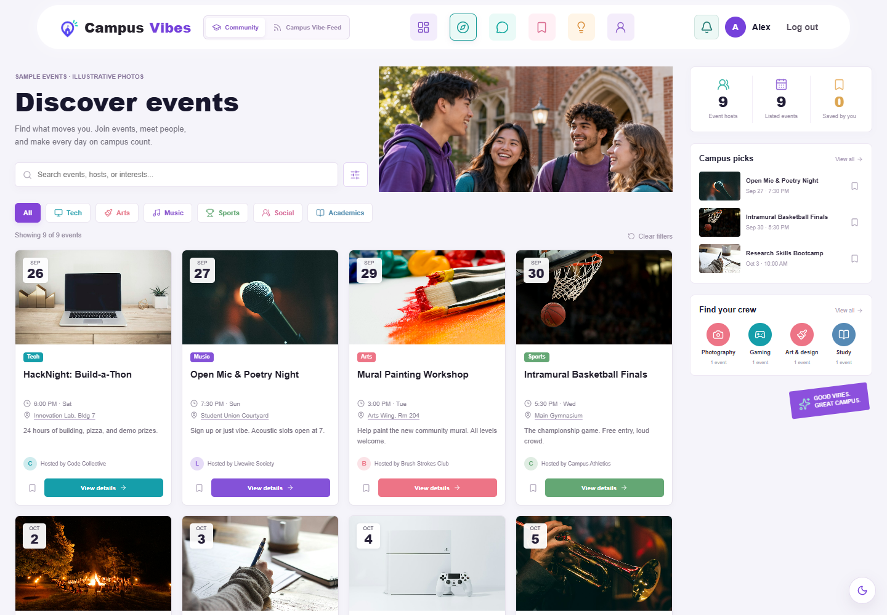
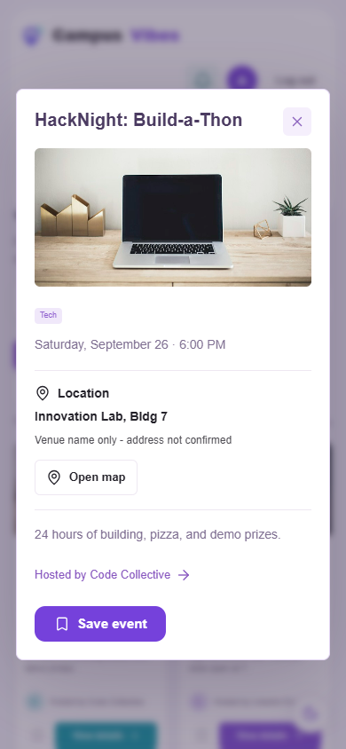
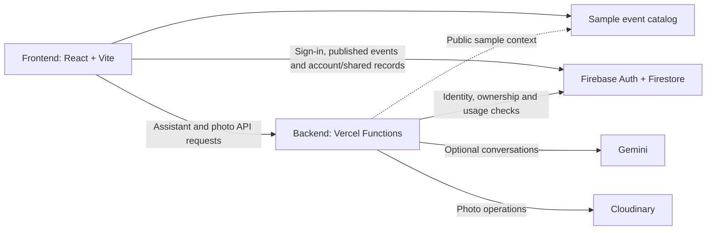

<div align="center">
  
  <h1>CampusVibes</h1>
  <p><strong>Discover campus events. Share campus moments. Stay connected.</strong></p>
  <p>Team 4 · Ulsan College · Capstone Design, Fall 2026</p>
  <p>
    <a href="https://campusvibe-theta.vercel.app/">Live website</a> ·
    <a href="#explore-events">Explore events</a> ·
    <a href="#quick-start">Quick start</a> ·
    <a href="#project-structure">Project structure</a> ·
    <a href="#testing">Testing</a> ·
    <a href="#team">Team</a>
  </p>
</div>

CampusVibes brings event discovery, campus updates, and student conversations into two connected workspaces: **Community** and **Campus Vibe-Feed**. It combines a React interface with Firebase account persistence and server-side integrations for AI conversations and photo sharing.

> **Event data:** Guest mode uses the nine illustrative events in [the sample catalog](frontend/events.json). Verified, signed-in accounts can also load published campus events from Firestore. Event cards label each listing as **Sample listing** or **Published campus event**. Published-event counts vary with available records and filters; guest demo activity stays in the browser. See [verification status](#verification-status) for the limits of the recorded checks.

## Preview



<details>
  <summary>View mobile event details</summary>
  <p align="center">
    
  </p>
</details>

These screenshots were captured from the local guest demo. The mobile image uses a browser viewport, not a physical-device test.

## Explore events

Open the [live website](https://campusvibe-theta.vercel.app/) and choose **Explore events** for the guest demo, or sign in with a verified account to access published listings and account features.

| Access | Event listings | Saved activity |
|---|---|---|
| **Guest demo** | Nine sample events; choosing Published events can return no results. | Guest saves stay in that browser. |
| **Verified account** | Sample events plus published campus events available through the account's Firestore permissions. | Saved events and personal plans synchronize with the account. |

Discover starts with **Upcoming**, which includes today in campus time (**KST**). Use the date controls to choose **Today**, **This weekend**, **All dates**, or **Past events**. Under **Listings**, choose **Published events**, **Sample listings**, or **All listings**; search, category and saved-only filters combine with that selection.

If no events appear:

1. Choose **All dates** or **Past events** to find older listings.
2. Clear the search text and category, select **All listings**, and turn off **Saved events only** if it is enabled.
3. Use **Clear filters** to restore the defaults. This returns the date to **Upcoming**, so an empty upcoming list can still be expected when the available events are in the past.
4. If a shared-events warning appears while signed in, check the connection and use **Retry shared events**. Follow the cached-data warning; sample listings remain a separate fallback.

## Features

| Area | Implemented behavior |
|---|---|
| **Event discovery** | Dashboard, event search and interest filters, sorting, event details, bookmarks, and Google Maps venue links. The trip planner fills the destination from the selected event and accepts a typed starting point or optional current location. It opens bus/train, walking, driving or cycling directions and searches nearby bus stops. |
| **Campus Vibe-Feed** | Shared text and event posts, one compressed photo per post through Cloudinary, likes, comments, interest, and private saved posts. |
| **Friends and messages** | Friend requests, accepted-friend conversations, unread indicators, read receipts, and earlier message history. Shared names, profile photos and college labels help distinguish people with the same name; internal member IDs are not displayed. |
| **Notifications** | One header inbox for both workspaces, Community/Feed filters, unread-only filtering, source links, and account-persistent read status. The inbox displays the latest 50 alerts. |
| **Event suggestions** | Saved drafts, an optional poster image, a shared review queue, reviewer decisions, and personal submission status. Authorized reviewer approval publishes an event into Discover. Anonymous submissions hide attribution from reviewers; project administrators retain access. |
| **Profile and badges** | Optional profile photo, editable bio/study details/interests, saved-event activity, and persistent progress badges. |
| **Assistant** | A local event helper with category/date/location filters and optional Gemini conversations for signed-in users, with privacy confirmation, usage controls, and local fallback. |
| **Authentication and persistence** | Firebase email/password accounts, Google sign-in and password-reset flows, session preferences, and private account synchronization. |

### Scope and limitations

The frozen demo path is **Landing → verified login → Dashboard → Discover → search/category → Event Details → session refresh → logout**. Feed, Assistant, profile, badges, suggestions, maps and notifications are supporting features. Their individual checks do not expand the frozen promise or provide final team approval.

- Sample events use illustrative venues; published-event locations come from their publication records. The trip destination automatically uses the event’s organizer-provided pin/address when present, otherwise its venue name, with an explicit unconfirmed-address note. Users can correct the destination for their trip or restore the event location; map searches do not establish a verified real-world pin. Google Maps supplies route distances, times and transit services where available; CampusVibes only estimates straight-line distance when both endpoints have coordinates. Starting points stay in memory for the open dialog and are cleared on close or account change.
- Suggestion poster uploads require Cloudinary configuration. Uploading a poster does not submit or publish the suggestion; submission and authorized reviewer approval are separate steps. Existing poster API/emulator checks do not establish a new live provider-upload result. Assistant Attach/Voice controls remain unavailable.
- Gemini has no live web search or access to private student messages. Its availability depends on server configuration and provider limits.
- Badges represent planning progress, not verified attendance or club membership.
- Google account/session results are recorded for the [named frozen candidate](docs/Week12/QA-Checklist.md). Provider-page readiness automation does not complete a real-account login or prove password-reset email delivery. Broader Firestore error/recovery verification and final team approval remain separate open checks.

## Quick start

Use **Node.js 24.x** for parity with the deployment, and npm. Run commands from the repository root unless stated otherwise.

```sh
git clone https://github.com/CapstoneDesign-Fall2026-UlsanCollege/Team_4_Capstone_project.git
cd Team_4_Capstone_project
npm ci
npm run dev
```

Open the URL printed by Vite. Choose **Explore events** to use the guest demo without creating an account. Real-account features require Firebase Authentication and the project's Firestore permissions.

The [Week 13 Setup Guide](docs/Week13/Setup-guide.md) provides the detailed live-access, local-setup and handoff instructions. The [Architecture Sketch](docs/Week13/Architecture-Sketch.md) explains the main code and service boundaries.

For a production build:

```sh
npm run build
```

The build output is `frontend/react-app/dist/`. Local development also mounts the backend handlers at `/api/assistant`, `/api/feed-photo` and `/api/suggestion-photo`.

## Project structure

```text
Team_4_Capstone_project/
├── backend/
│   ├── api/                 Server API entry points
│   ├── src/                 Gemini and Cloudinary request handlers
│   ├── firebase/            Firebase configs, Firestore rules and indexes
│   ├── tests/               Backend API and database-permission checks
│   └── package.json         Backend dependencies and scripts
├── frontend/
│   ├── index.html           Community markup mounted by React
│   ├── apps.js              Authentication, navigation and Community behavior
│   ├── dashboard.js         Dashboard interactions and progress
│   ├── discover.js          Event discovery and details
│   ├── events.json          Sample event catalog
│   └── react-app/
│       ├── api/             Thin Vercel adapters to backend/api/
│       ├── src/             React UI, client stores and portable helpers
│       ├── public/          App assets
│       ├── tests/           Frontend unit and browser checks
│       └── verification/    Dated test receipts and screenshots
├── docs/                    Team reports, planning and evidence
├── .github/                 Issue templates and README images
├── firebase.json            Root CLI compatibility configuration
├── package.json             npm workspace and root commands
└── package-lock.json        Shared dependency lockfile
```

The root Firebase configuration points to the resources in `backend/firebase/`. The small `frontend/react-app/api/` adapters preserve the existing Vercel deployment layout; server logic and provider dependencies belong to the backend package.

### Architecture



## Configuration

### Firebase

This checkout targets the Team 4 Firebase project. Browser configuration is in [src/firebase.js](frontend/react-app/src/firebase.js), and access rules and indexes are in [backend/firebase](backend/firebase/). The app does not read `VITE_FIREBASE_API_KEY` configuration variables.

Real sign-in requires the appropriate Firebase providers and authorized domains. Connecting a different Firebase project also requires updating the backend handlers' identity/project settings and deploying matching rules and indexes.

For Google sign-in, enable the Google provider and add the exact website hostname under **Firebase Authentication → Settings → Authorized domains**. Production uses `campusvibe-theta.vercel.app`; a Vercel deployment does not update this Firebase list. An omitted hostname produces `auth/unauthorized-domain`.

### Optional AI and photo services

For local provider integrations, create `frontend/react-app/.env.local`. The Vite development server reads these **server-side** variables:

```dotenv
GEMINI_API_KEY=replace_with_your_gemini_key
CLOUDINARY_CLOUD_NAME=ghr7xnsl
CLOUDINARY_API_KEY=replace_with_your_cloudinary_key
CLOUDINARY_API_SECRET=replace_with_your_cloudinary_secret
```

The Cloudinary cloud name must match `FEED_PHOTO_CLOUD` in [the photo contract](frontend/react-app/src/feed-photo.js). Photo uploads use Cloudinary; they do not use a Firebase Storage bucket.

Keep credentials out of Git and never prefix server secrets with `VITE_`. Set the same variables in Vercel's environment settings for the deployment environments that need them. Missing provider configuration leaves the local Assistant available and prevents shared photo uploads; text posts remain available.

## Testing

| Command, from the repository root | Purpose |
|---|---|
| `npm run build` | Build the production frontend. |
| `npm run test:backend` | Check backend authentication, request validation, ownership, provider behavior, and limits with controlled fixtures. |
| `npm run test:assistant --workspace frontend/react-app` | Check the local Assistant engine, search, and conversation behavior. |
| `npm run test:account --workspace frontend/react-app` | Check account persistence and synchronization logic. |
| `npm run test:notifications --workspace frontend/react-app` | Check notification types, source keys, filtering, and activity mapping. |
| `npm run test:maps --workspace frontend/react-app` | Check map URLs, trip modes, safe address encoding, coordinate validation and straight-line distance. |
| `npm run test:google-signin-live --workspace frontend/react-app` | Check the live Firebase domain allowlist, Google account-page handoff and popup-dismissal recovery on desktop/mobile viewports; no credentials are entered. |
| `npm run test:smoke` | Run the desktop/mobile browser suite. |
| `npm run test:rules` | Check Firestore permissions against a running local emulator. |

Install the browser once before running the smoke suite:

```sh
npx playwright install chromium
npm run test:smoke
```

The browser suite manages its preview server on port **4178**. An installed Google Chrome can also be selected with `SMOKE_BROWSER_CHANNEL=chrome`.

The live Google readiness check uses installed Chrome by default and targets the production URL. Set `GOOGLE_SIGNIN_TEST_URL` to check another configured website and `SMOKE_BROWSER_CHANNEL` to select a different installed browser channel. It checks provider-page readiness; it does not complete an account login or send a password-reset email.

<details>
<summary>Run the Firestore permission checks locally</summary>

Install the Firebase CLI and Java 21 or later. In one terminal, start the isolated demo emulators:

```sh
firebase emulators:start --project demo-campusvibe-feed --config backend/firebase/firebase.account-test.json --only auth,firestore
```

In a second PowerShell terminal, run:

```powershell
$env:FIRESTORE_EMULATOR_HOST = "127.0.0.1:8180"
npm run test:rules
```

To connect the development app and backend handlers to those same emulators, use these variables before starting the dev server:

```powershell
$env:VITE_FIREBASE_EMULATORS = "true"
$env:VITE_FIREBASE_AUTH_EMULATOR_PORT = "9199"
$env:VITE_FIREBASE_FIRESTORE_EMULATOR_PORT = "8180"
$env:FIREBASE_AUTH_EMULATOR_HOST = "127.0.0.1:9199"
$env:FIRESTORE_EMULATOR_HOST = "127.0.0.1:8180"
npm run dev
```

The client emulator switch is restricted to development on localhost. The test project ID is `demo-campusvibe-feed`.

</details>

Feature-specific [verification records](frontend/react-app/verification/) contain dated screenshots and test scopes. Automated browser checks and mobile viewports supplement the team's independent rehearsal evidence; they do not replace it. Older receipts describe the version they tested.

### Verification status

- **Candidate authentication:** November 23 manual retests by `ujjalpoudel75` and `tulseyy8848` each reported six passing Google sign-in/session checks on candidate `e5f1888`. See the [QA checklist](docs/Week12/QA-Checklist.md) and [peer notes](docs/Week12/Peer-Test-Notes.md) for the exact revision, steps and evidence limitations.
- **Outside-team handoff:** On November 28, `jn-oli` from Team 5 reported 22 passing documentation, guest and authenticated manual checks on the live website, including observed published-event listings. The [final reviewer feedback](https://github.com/CapstoneDesign-Fall2026-UlsanCollege/Team_4_Capstone_project/issues/211#issuecomment-7224367502) records that no team assistance was needed. Local installation and automated suites were not run during that trial; an exact deployed SHA and browser version were not recorded.
- **Remaining checks:** Manual Firestore terminal-error/Retry verification remains tracked in [#206](https://github.com/CapstoneDesign-Fall2026-UlsanCollege/Team_4_Capstone_project/issues/206). The actual final team approval decision remains tracked in [#177](https://github.com/CapstoneDesign-Fall2026-UlsanCollege/Team_4_Capstone_project/issues/177). Published-event display observations do not certify every database/security/error path or approve the full MVP.

## Deployment

The current Vercel project uses:

| Setting | Value |
|---|---|
| Root directory | `frontend/react-app` |
| Framework | Vite |
| Install command | `npm install` |
| Build command | `npm run build` |
| Output directory | `dist` |
| Source files outside the root directory | Included, for the backend workspace |

Application deployments and Firebase resource deployments are separate. The project owner can deploy the checked-in Firestore resources with an explicit target project:

```sh
npm run firebase:deploy -- --project YOUR_FIREBASE_PROJECT_ID
```

An application push alone does not deploy Firestore rules or indexes.

## Contributing and project records

Use focused branches and pull requests. Link the relevant issue, include the actual check or result, and distinguish implemented behavior from planned work and known limitations.

- [Issues and tracked work](https://github.com/CapstoneDesign-Fall2026-UlsanCollege/Team_4_Capstone_project/issues)
- [Pull requests](https://github.com/CapstoneDesign-Fall2026-UlsanCollege/Team_4_Capstone_project/pulls)
- [Team documentation](docs/)
- [Week 9 report](docs/Week9/Weekly-Report.md)
- [Week 10 report — ownership assignment](docs/Week10/Weekly-Report.md)
- [Week 12 QA report](docs/Week12/Weekly-Report.md)
- [Week 13 report and handoff plan](docs/Week13/Weekly%20Report.md)
- [Week 13 Setup Guide](docs/Week13/Setup-guide.md)
- [Architecture Sketch](docs/Week13/Architecture-Sketch.md)
- [Current code-area map and ownership audit](docs/Week13/Ai-use-audit-ownership.md)
- [Earlier area map and accepted backup contacts](docs/Week10/ai-use-and-code-ownership-audit.md#codebase-area-map)
- [Independent handoff feedback and documentation follow-up #211](https://github.com/CapstoneDesign-Fall2026-UlsanCollege/Team_4_Capstone_project/issues/211)
- [Feature verification records](frontend/react-app/verification/)

## Team

| Member | GitHub |
|---|---|
| Devyana | [DevyanaCT](https://github.com/DevyanaCT) |
| Tulsey | [tulseyy8848](https://github.com/tulseyy8848) |
| Ujjal Poudel | [ujjalpoudel75](https://github.com/ujjalpoudel75) |
| Prachi | [prachi2061](https://github.com/prachi2061) |

Instructor: **DJ Twone**. See [team members](docs/TEAM_MEMBERS.md) for the shared team record.

## License

This is an academic capstone repository. No project license has been specified.
