## Week 12 — Google Authentication Evidence (Tulseyy)

**Tester:** `tulseyy8848`  
**Date:** November 23, 2026  
**Candidate:** `e5f1888aa4600ac2013d6bda34a55554ba68195f`  
**Evidence ownership:** Screenshots captured by `tulseyy8848`.

### G1 — Google Account Selection

### G2 — Dashboard After Login

### G3 — Refresh Session

### G4 — Logout and Refresh

### G5 — Google Re-login

### G6 — Cancel Popup and Retry

---

## Week 12 — UI Regression Testing — Ujjal Poudel

**Tester:** `ujjalpoudel75`
**Date:** November 23, 2026

### Updated Discover Events
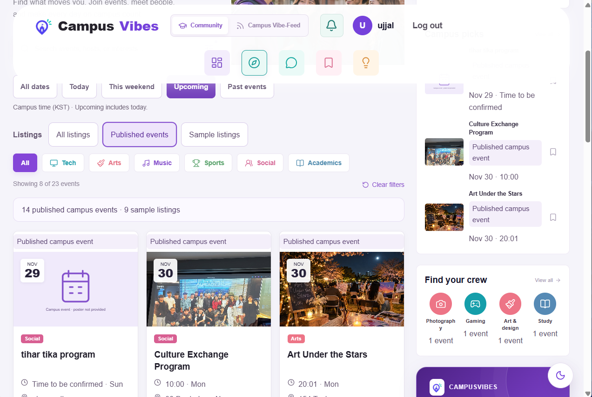

### Event Filters
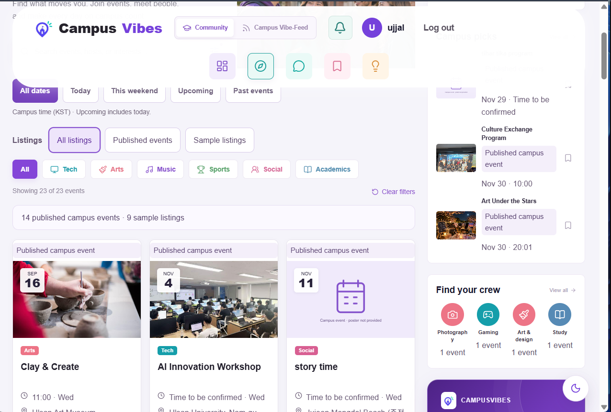

### Dashboard Search
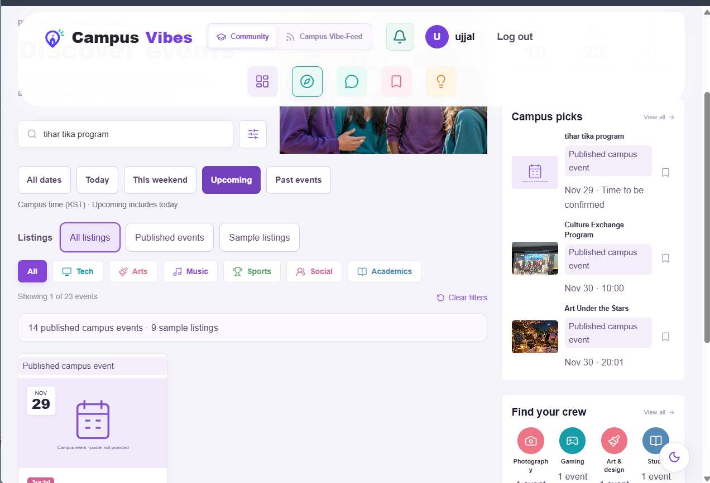

### Navigation
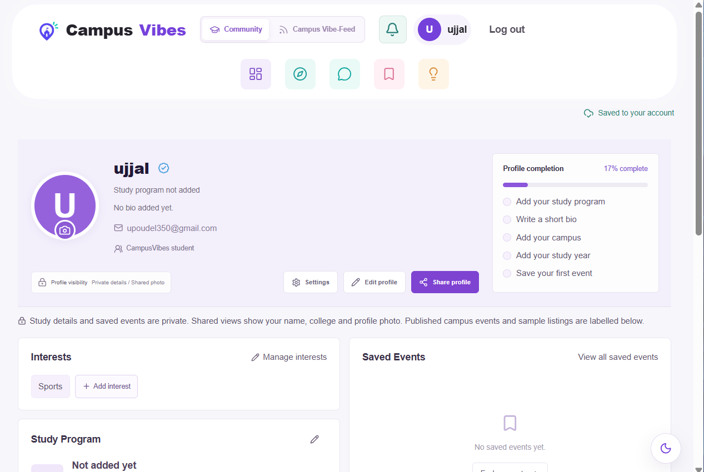

### Mobile Navigation
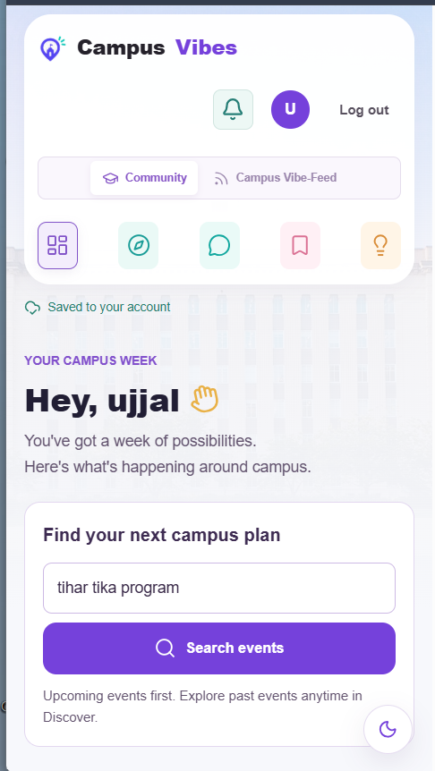

### Plan to go
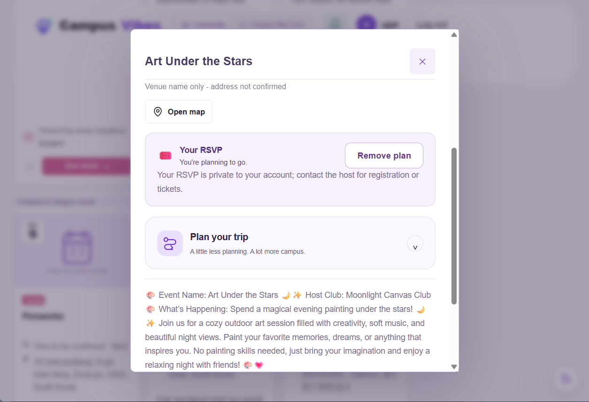

### Plan Persistence
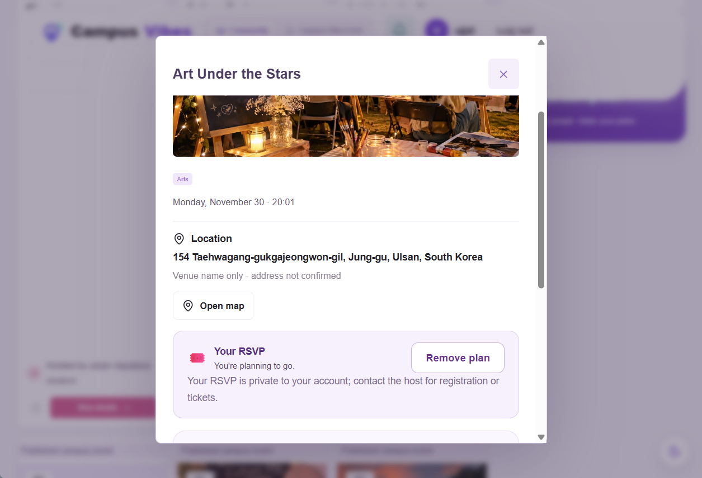

### Remove Plan
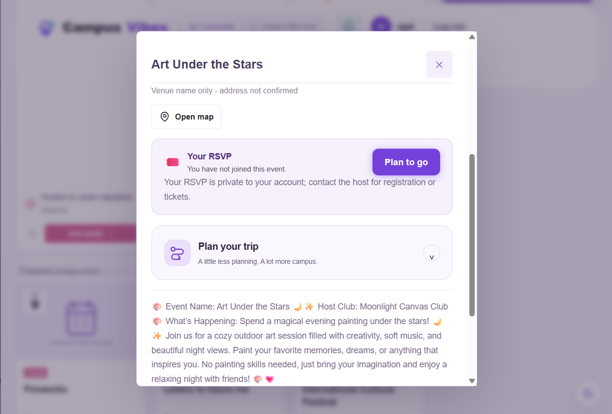

---

## Week 12 — Navigation Icon Regression Testing (PR #202)

**Tester:** `ujjalpoudel75`
**Date:** November 23, 2026
**Website:** https://campusvibe-theta.vercel.app/

### Desktop Navigation
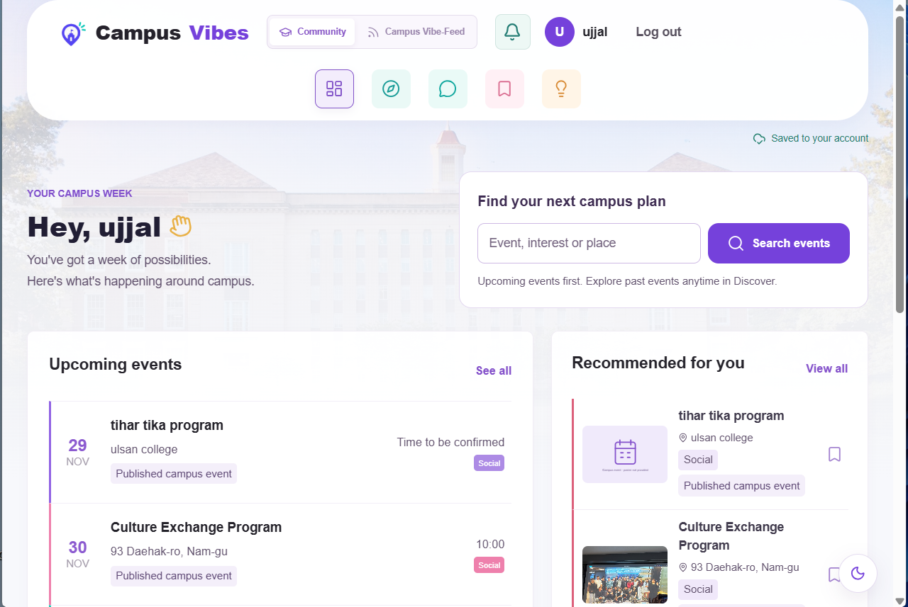

### Mobile Navigation
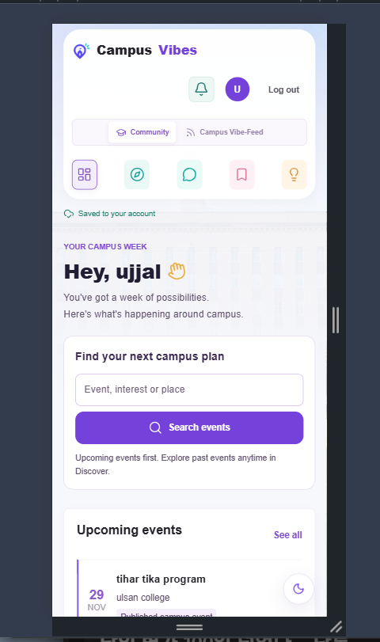

### Result
- Desktop navigation icons and tooltips: PASS
- Navigation between pages: PASS
- Mobile navigation at 390 x 844: PASS
- No horizontal overflow observed: PASS

**Status:** Manual testing completed.

---

## Week 12 — Google Authentication Evidence (Ujjal)

**Tester:** `ujjalpoudel75`
**Date:** November 23, 2026
**Candidate:** `e5f1888aa4600ac2013d6bda34a55554ba68195f`

### G1 — Google Account Selection
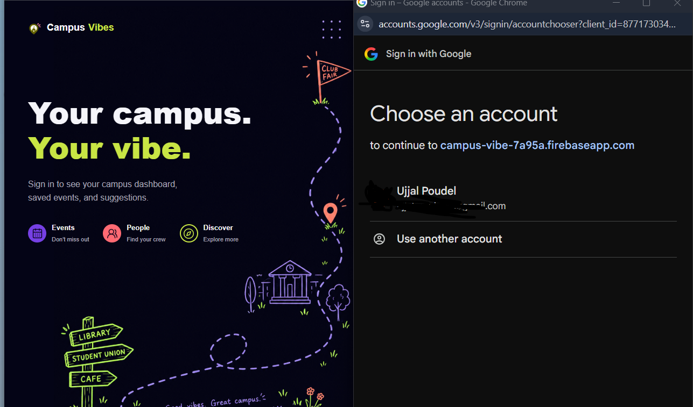

**Observation:** Google account-selection popup opened successfully.

### G4 — Signed-Out Login Page
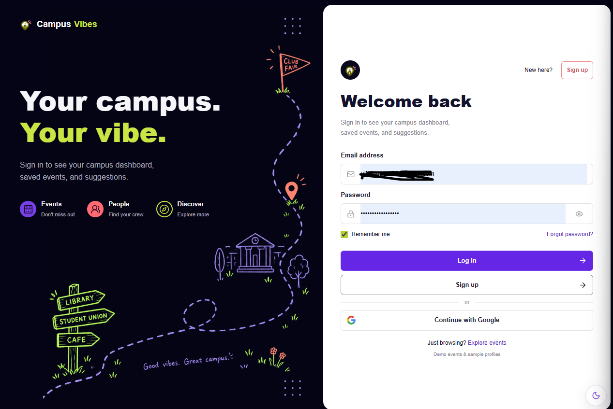

**Observation:** CampusVibes Login page displayed. Logout-and-refresh result documented separately in the manual QA report.

### Testing Summary

**G1-G6 Manual Testing:** 6 PASS, 0 reported FAIL.

These screenshots provide supporting visual evidence for selected authentication states. The complete test steps and results are recorded in Peer-Test-Notes.md and Issue #167.

