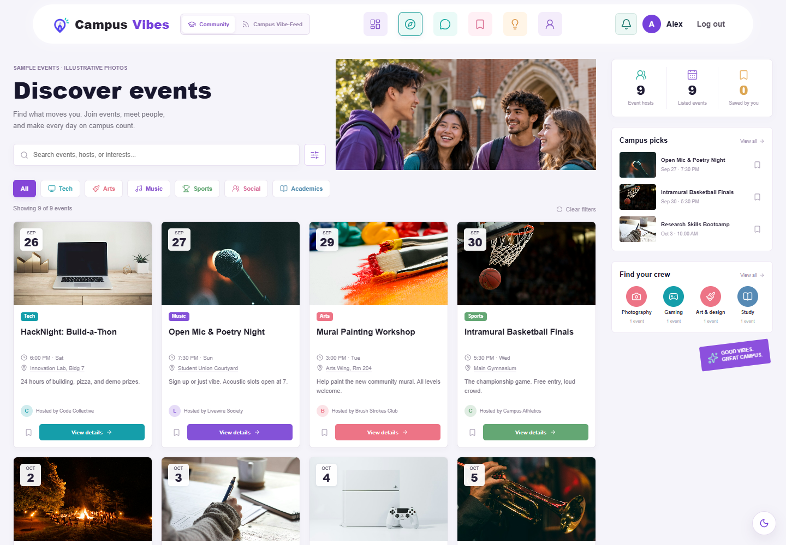
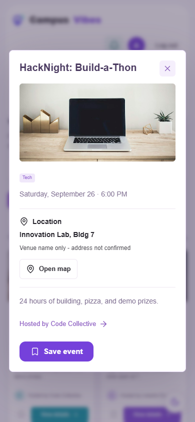

# Setup Guide

**Project:** CampusVibes — Team 4  
**Last updated:** November 26, 2026  
**Course:** Capstone Design — Fall 2026  
**Institution:** Ulsan College  

## What this project does

CampusVibes is a student-focused web application that helps students discover campus events, connect with other students, share campus moments, and manage their personal activities.

The application includes event discovery, search and filtering, community feeds, messaging, notifications, personal planning, and AI-assisted event discovery.

## Requirements

### For viewing the live application

- A computer, tablet, or smartphone.
- A modern web browser such as Google Chrome or Microsoft Edge.
- An internet connection.
- A registered account for authenticated features.
- No account is required for the guest demo.

### For running the project locally

- Git.
- Node.js 24.x.
- npm.
- Visual Studio Code or another code editor (optional).
- Access to the CampusVibes GitHub repository.

### Optional requirements

- Firebase CLI and Java 21 or later for emulator testing.
- Playwright Chromium for automated browser testing.
- Gemini API configuration for online AI conversations.
- Cloudinary configuration for shared photo uploads.

Guest-mode setup does not require private API keys or exclusive access to a team member's account.

## How to run or view the project

### Option 1 — View the live application

1. Open [CampusVibes](https://campusvibe-theta.vercel.app/).
2. Select **Explore Events** to access the guest demo.
3. Browse available events using Discover.
4. Search or filter events by category or interest.
5. Open an event to view its details.
6. Register or log in to access authenticated features.

### Option 2 — Run the project locally

1. Open PowerShell or a terminal.

2. Clone the project repository:

   ```sh
   git clone https://github.com/CapstoneDesign-Fall2026-UlsanCollege/Team_4_Capstone_project.git
   ```

3. Enter the project directory:

   ```sh
   cd Team_4_Capstone_project
   ```

4. Install project dependencies:

   ```sh
   npm ci
   ```

5. Start the development server:

   ```sh
   npm run dev
   ```

6. Open the local URL displayed in the terminal.

7. Select **Explore Events** to access the guest demo.

8. To stop the development server, press `Ctrl+C`.

### Production build

Run the following command from the repository root:

```sh
npm run build
```

The production build output is located in:

`frontend/react-app/dist/`

## How to test/check the project

### Manual verification

| Test ID | Test | Expected result |
|---|---|---|
| W13-01 | Open application | CampusVibes loads successfully. |
| W13-02 | Guest access | Discover opens without requiring login. |
| W13-03 | Event search | Relevant sample events are displayed. |
| W13-04 | Category filters | Events are filtered correctly. |
| W13-05 | Event details | Selected event information is displayed. |
| W13-06 | Empty search | An appropriate no-results state is displayed. |
| W13-07 | Login | Valid credentials open the authenticated application. |
| W13-08 | Dashboard | Dashboard and navigation work correctly. |
| W13-09 | Mobile layout | Main controls remain accessible and readable. |
| W13-10 | Page refresh | Application reloads without unexpected errors. |

These are proposed verification checks. Actual results must be recorded after execution.

### Automated verification

Run the following commands from the repository root.

Install the required browser:

```sh
npx playwright install chromium
```

Run the automated browser smoke tests:

```sh
npm run test:smoke
```

Verify the production build:

```sh
npm run build
```

Check backend behavior:

```sh
npm run test:backend
```

Check map and trip planner functionality:

```sh
npm run test:maps --workspace frontend/react-app
```

Check account persistence:

```sh
npm run test:account --workspace frontend/react-app
```

Check notification functionality:

```sh
npm run test:notifications --workspace frontend/react-app
```

Check the Assistant functionality:

```sh
npm run test:assistant --workspace frontend/react-app
```

Check live Google Sign-In readiness:

```sh
npm run test:google-signin-live --workspace frontend/react-app
```

The Google Sign-In readiness check verifies provider-page availability and popup-dismissal recovery. It does not complete a real-account login or verify password-reset email delivery.

### Week 13 independent handoff verification

We will check the setup instructions by asking a student outside Team 4 to independently view or run CampusVibes using the README, setup guide, and current area map without relying on a single area steward.

| Verification item | Details |
|---|---|
| Check | Independent setup, viewing, and documentation handoff |
| Expected result | The reviewer can access the application, follow the setup instructions, locate relevant code areas, and identify appropriate verification commands. |
| Actual result | Pending independent handoff trial. |
| Reviewer | Pending |
| Testing date | Pending |
| Proof | Peer Test Notes and screenshots to be linked after the trial. |

Any confusion, unsuccessful steps, or documentation gaps identified during the trial will be recorded and addressed.

## Where to find code areas and checks

### Current area map and documentation

- [AI Use and Code Ownership Audit](../Week10/ai-use-and-code-ownership-audit.md)
- [Project README](../../README.md)
- [Feature Verification Records](../../frontend/react-app/verification/)
- [Team Documentation](../)
- [GitHub Issues](https://github.com/CapstoneDesign-Fall2026-UlsanCollege/Team_4_Capstone_project/issues)
- [GitHub Pull Requests](https://github.com/CapstoneDesign-Fall2026-UlsanCollege/Team_4_Capstone_project/pulls)

### Code boundaries

| Area | Code location | Verification |
|---|---|---|
| Authentication and navigation | `frontend/apps.js` | Manual login and navigation checks |
| Dashboard | `frontend/dashboard.js` | Browser smoke tests |
| Event discovery | `frontend/discover.js` | Search, filtering, and event detail checks |
| Sample event data | `frontend/events.json` | Event catalog verification |
| React application | `frontend/react-app/src/` | Build and browser smoke tests |
| Backend API entry points | `backend/api/` | Backend automated tests |
| Backend services | `backend/src/` | Backend automated tests |
| Firebase configuration | `backend/firebase/` | Firestore permission tests |
| Frontend automated testing | `frontend/react-app/tests/` | Browser and feature-specific checks |
| Backend automated testing | `backend/tests/` | Backend and database-permission checks |
| Documentation and evidence | `docs/` | Independent handoff review |

### Cross-area handoff

The application contains several connected areas that a new maintainer should understand.

| Cross-area connection | Description |
|---|---|
| Discover → Event catalog | Discover reads the code-based sample event catalog in `frontend/events.json`. |
| Frontend → Firebase | Authentication and account/shared data depend on Firebase Authentication and Firestore. |
| Frontend → Backend | Server-side integrations are accessed through `/api/assistant` and `/api/feed-photo`. |
| Backend → Gemini | Optional online AI conversations depend on Gemini configuration. |
| Backend → Cloudinary | Shared photo uploads depend on Cloudinary configuration. |
| Application → QA | Browser smoke tests, backend tests, and feature-specific checks provide verification evidence. |

### Which check should a new teammate or maintainer run first?

The recommended first check is opening the live application in guest mode and verifying event discovery.

For local development, run:

```sh
npm ci
npm run build
```

After the build succeeds, install Chromium and run the browser smoke tests:

```sh
npx playwright install chromium
npm run test:smoke
```

If a check fails, review the relevant code area, existing verification records, and GitHub issues before making changes.

### Who can help with a handoff if the relevant steward is unavailable?

| Team member | GitHub |
|---|---|
| Ujjal Poudel | [ujjalpoudel75](https://github.com/ujjalpoudel75) |
| Devyana | [DevyanaCT](https://github.com/DevyanaCT) |
| Prachi | [prachi2061](https://github.com/prachi2061) |
| Tulsey | [tulseyy8848](https://github.com/tulseyy8848) |

Consult the current [AI Use and Code Ownership Audit](../Week10/ai-use-and-code-ownership-audit.md) for area-specific primary and backup contacts.

All team members can refer to the shared repository, documentation, verification records, and GitHub issues.

The basic setup and guest verification process should not depend on one student's private files, credentials, or account.

## Known problems

| Problem or limitation | Proposed severity | Workaround or plan |
|---|---|---|
| Live production Firestore event loading remains unverified in the current README. | Major | Use the documented sample event catalog within the approved demo scope. |
| Gemini availability depends on provider configuration. | Minor | Use the local Assistant fallback. |
| Photo uploads require Cloudinary configuration. | Minor | Use text-only community posts when photo services are unavailable. |
| Google authentication depends on Firebase-authorized domains. | Major if unavailable | Verify provider and domain configuration; use email/password authentication as an alternative where available. |
| Event suggestion approval does not automatically publish events. | Minor | Treat suggestions as a separate review workflow. |
| Sample event locations may not have verified coordinates. | Minor | Confirm or correct the destination before requesting map directions. |
| Independent Week 13 handoff verification is pending. | Pending assessment | Conduct an outside-student trial and document the results. |

These limitations and proposed severity classifications must be checked against the team's frozen MVP and latest verification records.

## Frozen MVP and final-demo protection

This setup guide supports the existing CampusVibes application and does not introduce changes to application functionality.

- Preserve the existing working features.
- Do not change authentication or database security rules during documentation work.
- Do not expose private credentials or API secrets.
- Distinguish sample data from verified live production data.
- Distinguish implemented features from verified final-demo features.
- Do not report unexecuted tests as PASS.
- Review the frozen final-demo promise against independent handoff results.
- Update roadmap risks or fallbacks if the handoff trial identifies a gap affecting the final demonstration.

## Demo link or screenshots

- [Live CampusVibes Application](https://campusvibe-theta.vercel.app/)
- [GitHub Repository](https://github.com/CapstoneDesign-Fall2026-UlsanCollege/Team_4_Capstone_project)
- [Project README](../../README.md)
- [Desktop Preview](../../.github/assets/campusvibes-desktop.png)
- [Mobile Preview](../../.github/assets/campusvibes-mobile.png)
- [Feature Verification Records](../../frontend/react-app/verification/)

### Desktop preview



### Mobile preview



The existing screenshots demonstrate the local guest interface. The mobile screenshot represents a browser viewport rather than physical-device verification.

New Week 13 handoff screenshots will be added after independent testing.

## Week 13 Handoff Status

- [x] Project purpose documented.
- [x] Setup instructions documented.
- [x] Software requirements documented.
- [x] Live application access instructions documented.
- [x] Local development instructions documented.
- [x] Code boundaries documented.
- [x] Cross-area connections documented.
- [x] Testing commands documented.
- [x] Known limitations documented.
- [x] Shared support contacts documented.
- [ ] Documentation reviewed against the latest frozen MVP records.
- [ ] Independent setup or viewing trial completed.
- [ ] Outside reviewer locates the area map and relevant checks.
- [ ] Independent screenshot evidence collected.
- [ ] Peer Test Notes completed and linked.
- [ ] Documentation improved using independent feedback.
- [ ] Roadmap risks or fallbacks reviewed.
- [ ] Documentation pull request submitted.
- [ ] Weekly Report updated with evidence links.

## Completion criteria

The Week 13 setup and handoff task will be considered complete when an independent reviewer can understand, view, or run CampusVibes using the shared documentation without depending on a single team member.

The reviewer must also be able to locate the relevant code areas, verification commands, and shared support contacts.

The handoff results, observed difficulties, documentation improvements, and supporting evidence must be linked in GitHub.

---

---

**Prepared by:** Devyana (`DevyanaCT`)  
**Team:** Team 4 — CampusVibes  
**Week:** 13 — Documentation, Setup, and Handoff Proof  
**Date:** November 26, 2026  
**Status:** Setup Guide Draft — Independent Handoff Verification Pending
