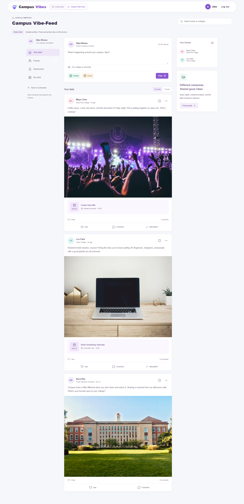
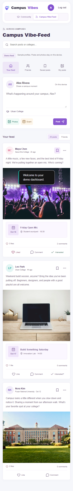

# Feed Workspace and Responsive Verification

Recorded on 2026-10-13 for [Issue #56](https://github.com/CapstoneDesign-Fall2026-UlsanCollege/Team_4_Capstone_project/issues/56).

## Delivered Implementation

The Community / Campus Vibe-Feed mode switch and cross-college demo layout are already on `main` in [ea4dec0](https://github.com/CapstoneDesign-Fall2026-UlsanCollege/Team_4_Capstone_project/commit/ea4dec0). Narrow-screen long-text handling was improved in [8f84912](https://github.com/CapstoneDesign-Fall2026-UlsanCollege/Team_4_Capstone_project/commit/8f84912).

This follow-up contributes verification evidence only. It does not submit the existing runtime code again or modify the deployed interface.

## Production Screenshots

Captured by automated browser checks at [CampusVibes](https://campusvibe-theta.vercel.app), using the Alex demo session and fictional sample profiles. The desktop capture precedes demo interactions; the mobile capture follows the workflow checks. Neither contains personal credentials or user-uploaded private photos.

Desktop, 1536px:

Mobile, 390px:

## Automated Results

- Explore events entered demo Discover; selecting Campus Vibe-Feed showed the labeled device-local feed with three sample posts.
- Switching back to Community retained working navigation to Discover and Dashboard; returning to the feed kept its device-local state.
- The feed had no document horizontal overflow at 1536, 1280, 1024, 768, 390, and 320px. All six Community header icon buttons remained inside the viewport at those widths.
- A controlled local-UID test at 320px checked a 120-character student name, 100-character college name, 100-character event title, and 120-character location. Target labels and document content fit without horizontal overflow.
- No uncaught page errors were reported by the main production feed workflow check.

The local-UID case exercises rendering with synthetic data, not a real Firebase account or server-side permissions. These checks are automated, not independent teammate rehearsal; that remains [Issue #53](https://github.com/CapstoneDesign-Fall2026-UlsanCollege/Team_4_Capstone_project/issues/53).

## Repeatable Review

1. Open production signed out and select Explore events. Choose Campus Vibe-Feed in the signed-in header.
2. Confirm the demo banner states that posts/photos stay on this device and the sample profiles span colleges.
3. Switch to Community, visit Discover and Dashboard, then return to the feed. Check that each workspace is usable and its controls remain visible.
4. Repeat at desktop, tablet, 390px, and 320px widths. Check icon spacing, keyboard focus, labels, and horizontal overflow.
5. In a disposable local session, use long names, college/event titles, and locations to check wrapping. Do not claim this is teammate or real-account testing.

## Scope Limits

This is an across-college demo interface, not a shared social network. Workspace preference is browser-local and account-scoped; Explore events intentionally starts in Community Discover. Sample friends, posts, and photos do not establish live campus data or backend publishing.
