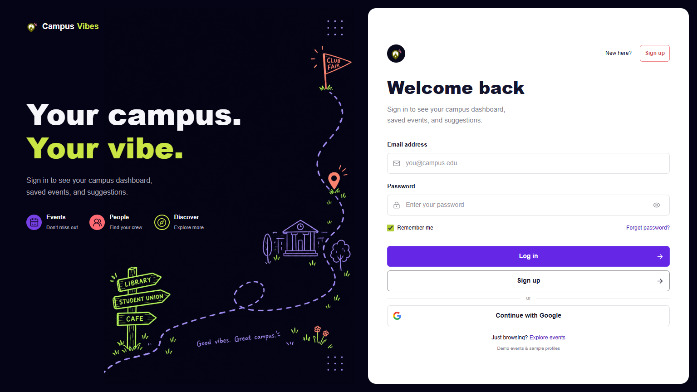
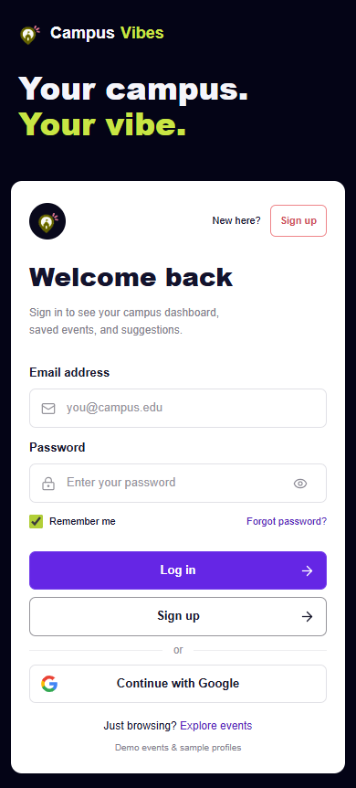

# Login Redesign Verification

Recorded on 2026-10-13. Tracking: [Issue #54](https://github.com/CapstoneDesign-Fall2026-UlsanCollege/Team_4_Capstone_project/issues/54).

## Implementation and Deployment

The dark-and-lime login implementation was committed directly to `main` in signed, GitHub-Verified commit [f73de35](https://github.com/CapstoneDesign-Fall2026-UlsanCollege/Team_4_Capstone_project/commit/f73de35). Its Vercel GitHub deployment status reported success, and the updated public page was checked at [CampusVibes](https://campusvibe-theta.vercel.app).

This evidence-only follow-up does not submit the original implementation for review again or claim it was developed on this PR branch. It changes no runtime code, Firebase settings, billing, or weekly reports.

## Production Screenshots

Signed-out screenshots were captured by automated browser checks on the public production URL. They contain no test account credentials or user-entered passwords.

Desktop, 1536px:

Mobile, 390px:

## Checks Completed

- `npm run build` passed in `frontend/react-app`.
- Chrome browser checks found no horizontal overflow at 1536, 1024, 768, 390, and 320px. Logos, Google icon, and Lucide controls rendered.
- Password visibility, inline validation, signup reopening, Escape dismissal, and return focus passed.
- Real Firebase email/password signup, incorrect-password rejection, login, logout, and unchecked Remember me session persistence passed locally and on production. Disposable test accounts were deleted after each run.
- The existing sample-event filters, saved events, Assistant, local suggestion drafts, and browser-local profile editing passed production browser checks. These checks do not establish Firestore event integration.
- Explore events opened the demo Discover page; switching to the dashboard and demo feed, then logging out, returned to the new login screen.
- Demo-feed regression checks passed locally: search, audience filters, likes, comments, saved posts, event/photo publishing, photo persistence across reload, editing/deleting own posts, demo friend requests, and Community navigation.
- Reset confirmation and Google provider/configuration-error handling passed controlled stub checks. No real reset-email delivery or successful Google account login was claimed.

These are automated checks, not independent teammate rehearsal. The separate rehearsal task remains [Issue #53](https://github.com/CapstoneDesign-Fall2026-UlsanCollege/Team_4_Capstone_project/issues/53).

## Repeatable Smoke Check

Use only disposable test accounts. Do not put credentials, tokens, or private email contents in screenshots or issue comments.

1. Open the production URL signed out. Check desktop and mobile layouts, assets, email/password fields, and the password eye control.
2. Submit empty credentials and confirm readable field errors. Open signup, submit an incomplete form, close it with Escape, and repeat to confirm errors remain visible.
3. Create a disposable email/password account. Confirm the signed-in view, then log out. Reject an incorrect password, then log in successfully with Remember me unchecked. Reload and confirm the session remains in the same tab; close the tab and verify that session-only sign-in does not persist into a fresh tab.
4. Choose Explore events and confirm demo listings. Switch to Campus Vibe-Feed, publish a disposable post with a photo, reload, choose Explore events and select the feed again, and confirm device-local persistence. Delete the test post.
5. Delete any disposable Firebase accounts after testing. A test account must not be mistaken for a real student or a completed teammate rehearsal.

## Still Pending

- **Google sign-in:** use a test Google account to verify provider/domain configuration, complete the actual popup flow, and confirm login/logout. A configuration error was not independently confirmed; do not label one as a bug without reproducing it.
- **Reset email:** use an owned test email to request a real reset link, receive it, set a new password, and verify login with that password.

Record these actual outcomes in Issue #54. This evidence PR does not close that issue automatically, because both interactive checks remain outstanding.
